# 🚕 Taksi — Full-Stack Ride-Hailing Platform

A complete, real-time taxi ecosystem (in the spirit of Yandex Go / Uber) built from scratch with **React, TypeScript, Node.js, Socket.io and PostgreSQL + PostGIS**.
Four apps in one codebase — **Passenger**, **Driver**, **Dispatcher** (phone orders) and **Admin** — with live GPS tracking, route-based pricing, surge pricing, a driver wallet with commission, a driver quality score and passwordless login via a Telegram bot.

> UI language: Uzbek 🇺🇿 · Map: OpenStreetMap · 100% free / open-source stack

<p align="center">
  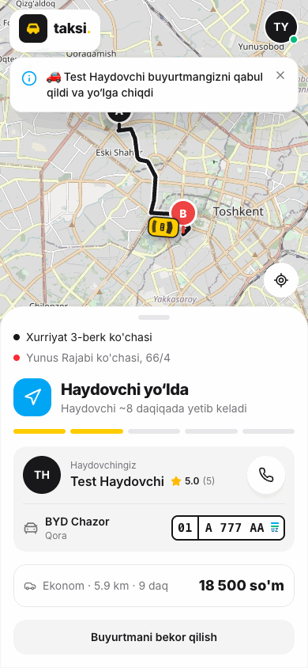
</p>
<p align="center"><i>Passenger sees the driver's car move on the map in real time, with ETA, car model and plate number.</i></p>

---

## ✨ Features

### 👤 Passenger
- Pick **A → B** on the map or by address search (OpenStreetMap / Nominatim geocoding)
- **Route, distance and ETA** drawn on the map (OSRM routing)
- **3 tariffs** — Economy, Comfort, Delivery — with transparent price breakdown (base fare, per-km, per-minute, free waiting time)
- **Surge pricing** shown *before* ordering; if demand rises while the passenger decides, the server asks to re-confirm the new price
- **Live tracking**: driver card with name, rating, **car model, colour and Uzbek-style licence plate**, "arrives in ~N min" ETA, smooth animated car marker
- Trip progress: searching → accepted → arrived → in trip → completed, with in-app and browser notifications
- **Rate the trip** 1–5★ with quick comments; trip history grouped by day
- Cancel before pickup; the order is cancelled automatically if no driver is found within 15 minutes

### 🚖 Driver
- Online/offline switch, **GPS streaming** (real GPS or built-in simulator for testing)
- New orders sorted by distance with a **repeating sound alert + vibration** until handled, and background browser notifications
- Accept → Arrived → Start trip → Finish; waiting-fee is calculated automatically after free waiting time
- Phone orders from the dispatcher: call the customer in one tap, enter the final price when the destination was unknown
- **Earnings**: today / 7 days / 30 days, rating, trip history
- **Wallet**: 10% commission (admin-configurable) is deducted per completed trip; **no new orders when the balance is negative**
- **Quality score (0–100)** with three zones:
  🟢 70–100 orders instantly · 🟡 40–69 orders arrive 15 s later · 🔴 below 40 — 60-minute pause.
  +2 per trip, +1 for 5★, −5 for 1–2★, −10 for cancelling, +3 daily recovery. Every change is logged with a reason.
- Car registration (model, colour, plate); changing the plate sends the driver back to admin approval

### ☎️ Dispatcher (orders by phone)
- For customers who call a short number (no smartphone needed)
- Phone lookup shows the **caller's name and previous addresses** for one-click repeat orders
- Pickup by map, search **or just a landmark text** ("near school 19, blue gate"); destination optional
- Send to the nearest drivers or **assign to a specific driver**; several cars per call; duplicate-order protection

### 🛠 Admin
- **Live monitoring**: all online drivers on the map, active orders, today's trips and revenue
- **Drivers**: approve / revoke, block / unblock (instantly disconnects), see rating, car, balance and score
- **Driver wallet**: top up (cash at the office), corrections with mandatory note, full balance & score history, manual score adjustment
- **Orders history**: search by phone, name, address or plate; filter by status, source and date; **export to Excel (CSV)**
- **Tariffs** editable live (passenger prices update instantly), **surge** on/off with max multiplier, **commission %**
- Manage dispatcher accounts

### 🔐 Authentication
- **Passwordless login via Telegram bot**: enter phone → 6-digit code arrives in Telegram. On first login the user shares their contact in the bot, so **Telegram itself verifies the phone number** (sharing someone else's contact is rejected)
- New users choose a role (passenger / driver) and drivers enter car details during sign-up
- Email + password login and password reset as a fallback
- Role-based routing and protected pages

---

## 📸 Screenshots

| Telegram login | Route & tariffs | Driver gets an order | Driver on the way |
|:---:|:---:|:---:|:---:|
| 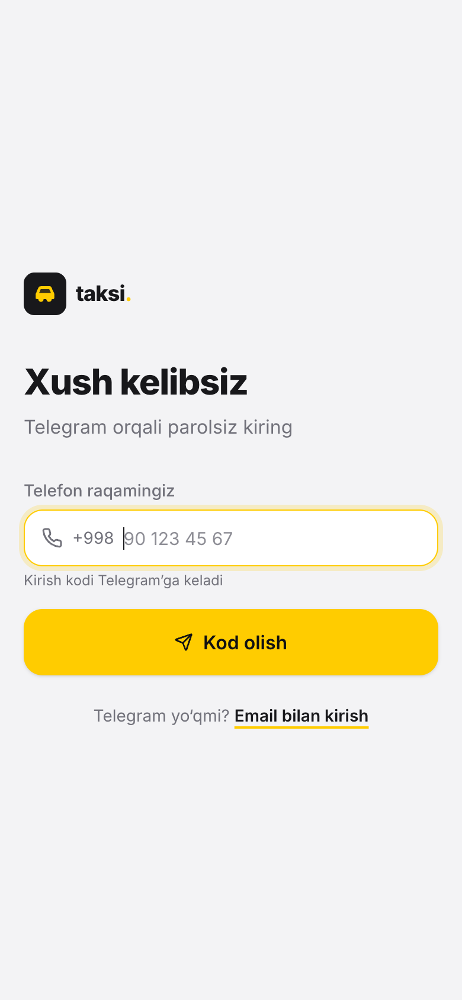 | 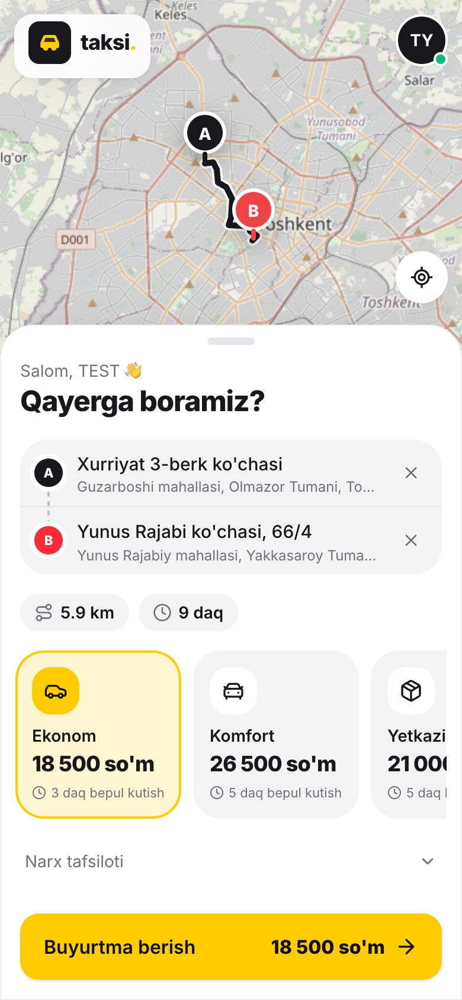 | 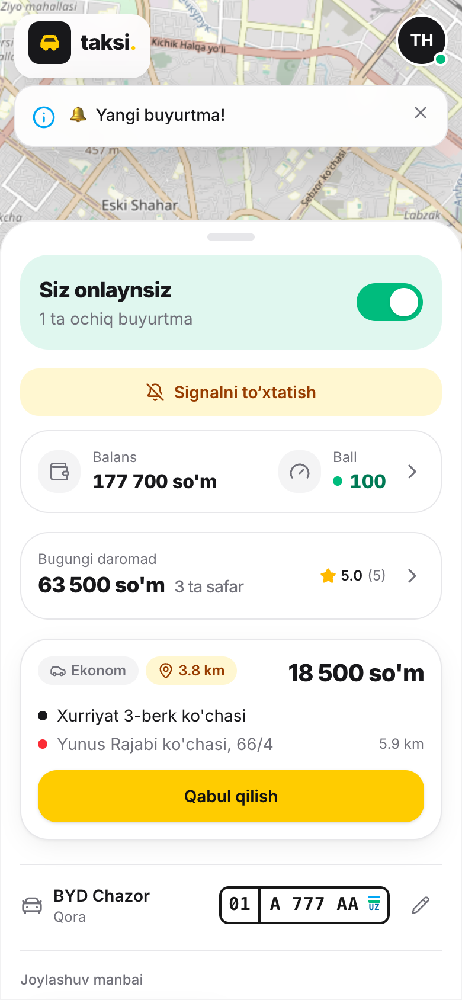 | 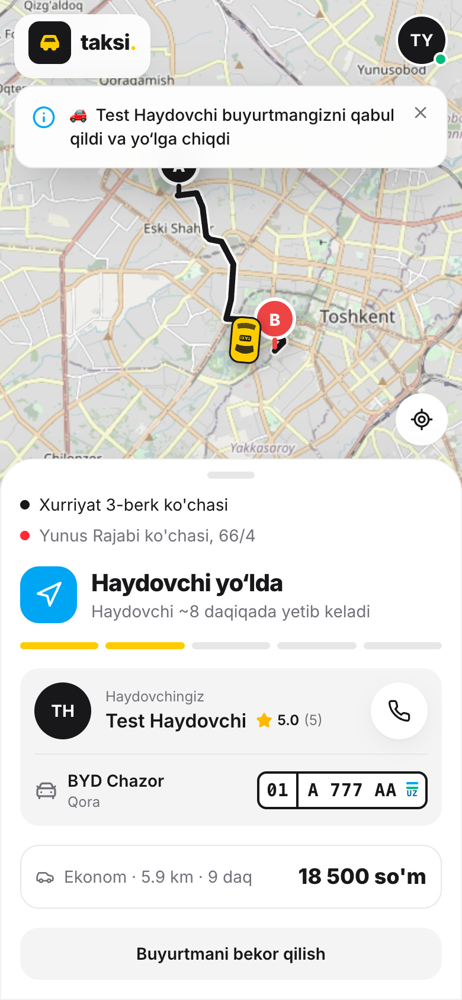 |

| Rate the trip | Driver trip screen | Wallet & score | Earnings |
|:---:|:---:|:---:|:---:|
| 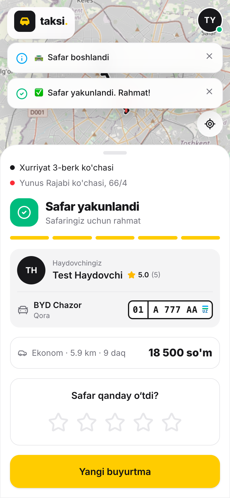 | 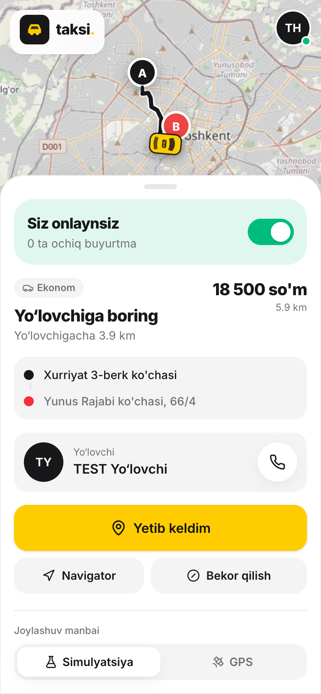 | 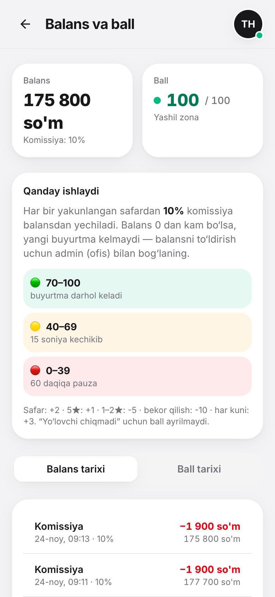 | 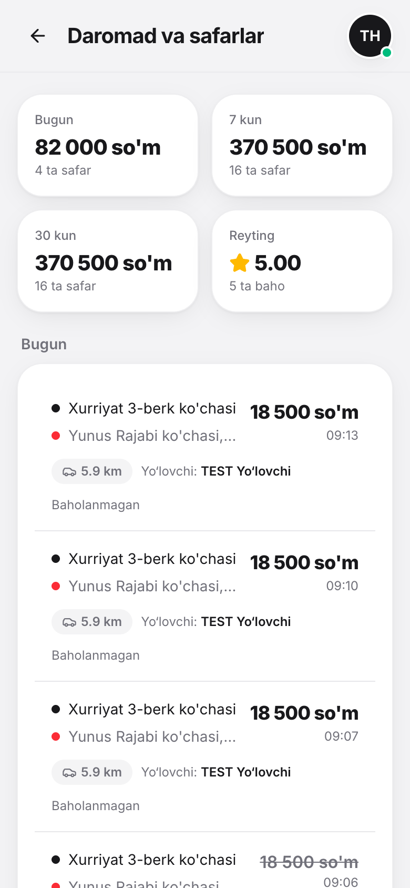 |

**Passenger — desktop**
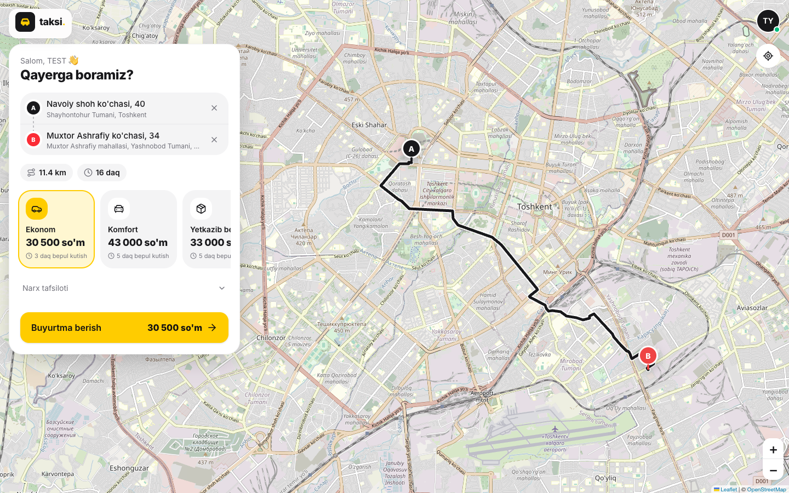

**Admin — live monitoring**
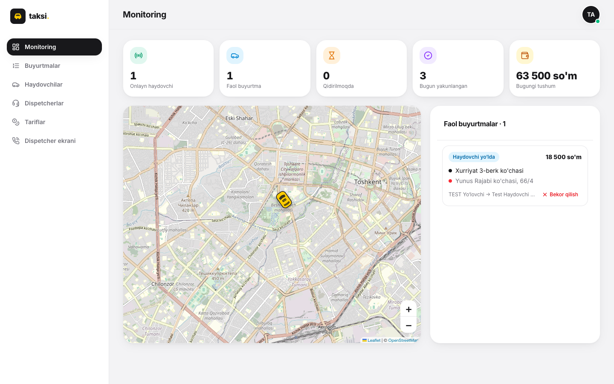

<details>
<summary><b>More admin & dispatcher screens</b></summary>

**Drivers** 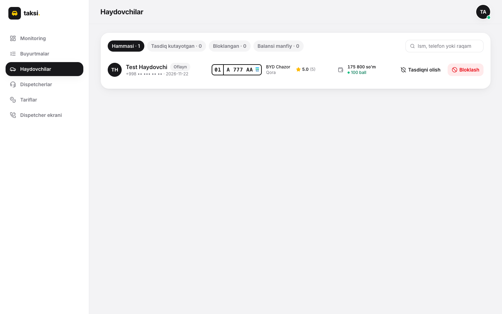
**Driver wallet** 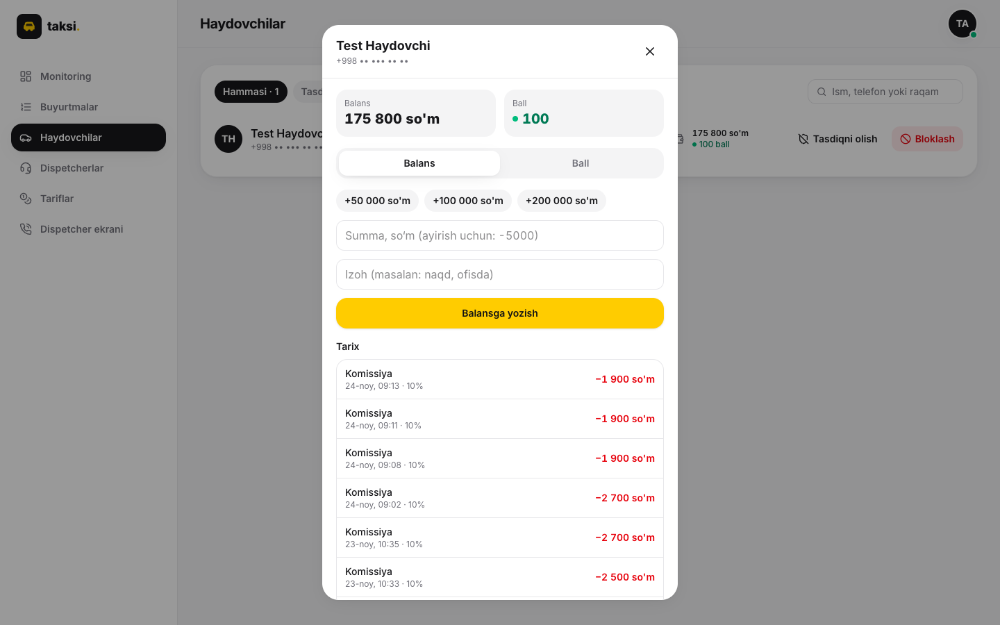
**Orders history + Excel export** 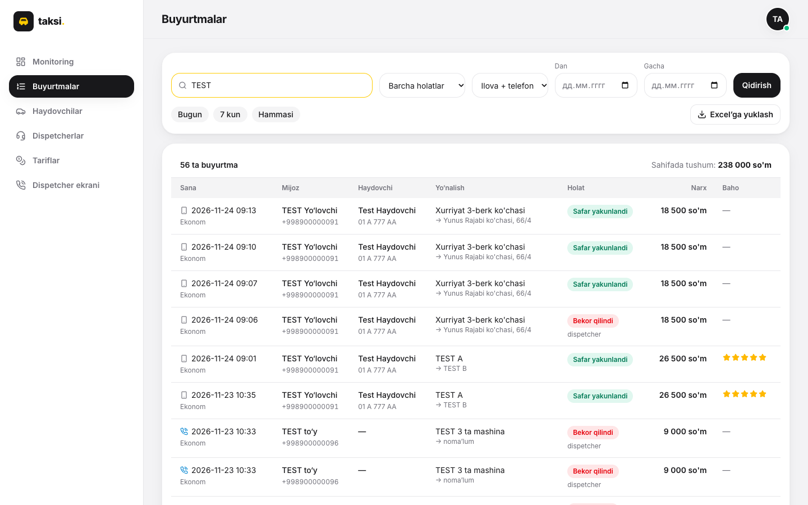
**Tariffs, surge & commission** 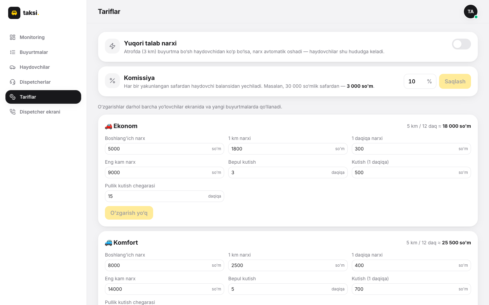
**Dispatcher — phone order with previous addresses** 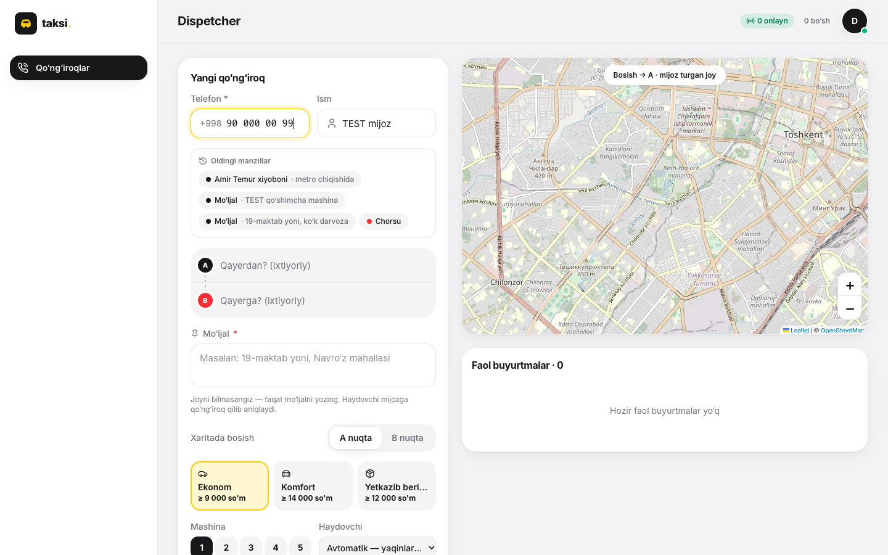
**Login (desktop)** 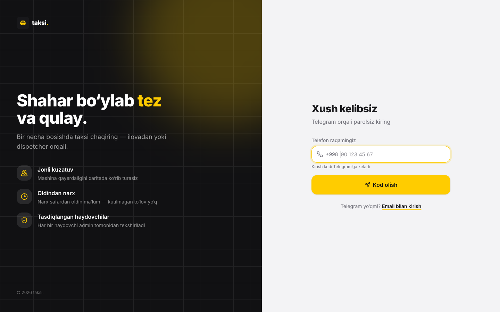

</details>

> Screenshots use test accounts only.

---

## 🏗 Architecture

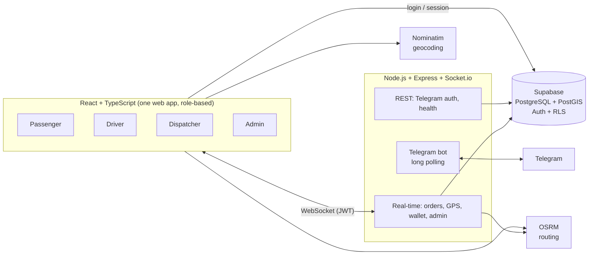

**Order flow:** passenger creates an order → the server recalculates distance and price (clients are never trusted) → PostGIS finds online drivers within 5 km (green-zone drivers first, yellow-zone after 15 s, negative-balance / paused drivers excluded) → the first driver to accept wins (atomic update) → the driver's GPS is streamed to the passenger → on completion commission and score are applied in a single database transaction.

---

## 🧰 Tech stack

| Layer | Technologies |
|---|---|
| Frontend | React 19, TypeScript, Vite, Tailwind CSS v4, Zustand, React Router, Leaflet / React-Leaflet, Lucide icons |
| Backend | Node.js, Express 5, Socket.io 4, TypeScript (tsx) |
| Database & Auth | Supabase — PostgreSQL, **PostGIS** (geo queries), Row Level Security, SQL functions for atomic wallet/score updates |
| Maps | OpenStreetMap tiles, **OSRM** routing, **Nominatim** geocoding |
| Integrations | Telegram Bot API (OTP login) |
| Testing | Vitest (unit), end-to-end scripts against the running backend |
| Dev tooling | oxlint, HTTPS LAN dev mode, Cloudflare Tunnel for phone testing |

---

## 🛡 Engineering highlights

- **Server-authoritative pricing** — distance, duration, surge and final price are always computed on the server.
- **Geo queries in the database** — `ST_DWithin` / `ST_Distance` on `geography` for nearby drivers and surge demand/supply within 3 km.
- **Race-safe dispatch** — accepting an order is a conditional update (`status = 'created' AND driver_id IS NULL`), so two drivers can never take the same order.
- **Atomic money operations** — balance and score change only through PL/pgSQL functions; a unique index guarantees commission is charged once per trip.
- **Security hardening** — per-user and per-IP rate limits for socket events and connections, early rejection of malformed/expired tokens, 64 KB payload limit, max 5 sockets per user, internal DB errors hidden from clients, CSV formula-injection protection, CSP & security headers, RLS so users can only read their own profile.
- **Telegram OTP** — codes are stored only as hashes, expire after 5 minutes, max 5 attempts, 60 s resend cooldown.
- **Resilient real-time** — reconnect restores the active order and the driver's last position; stale orders are swept automatically.

---

## 📁 Project structure

```
taksi-app/
├── frontend/              # React app (passenger, driver, dispatcher, admin)
│   └── src/
│       ├── pages/         # passenger/ driver/ dispatcher/ admin/ auth/ history/ wallet/
│       ├── components/    # UI kit, map shell, order cards, driver widgets
│       ├── maps/          # Leaflet map, route, animated car marker, GPS hook
│       ├── store/         # Zustand stores (auth, orders, driver, wallet, admin…)
│       └── services/      # Supabase, Socket.io, OSRM, Nominatim, Telegram auth
├── backend/
│   ├── src/
│   │   ├── sockets/       # real-time events (orders, GPS, admin, wallet)
│   │   ├── services/      # orders, pricing, surge, wallet/score, history, Telegram bot & auth
│   │   ├── routes/        # REST endpoints
│   │   └── security.ts    # rate limits, token pre-check, headers
│   ├── supabase/          # SQL migrations 001 … 013 (schema, PostGIS, RLS, functions)
│   └── scripts/           # e2e tests and a driver simulator
├── shared/                # code shared by frontend & backend: pricing, statuses, wallet rules (+ tests)
└── docs/screenshots/
```

---

## 🚀 Getting started

**Requirements:** Node.js 22+, a free [Supabase](https://supabase.com) project, optionally a Telegram bot token from [@BotFather](https://t.me/BotFather).

1. **Database** — in Supabase → SQL Editor run the files in `backend/supabase/` **in order** (`001_init.sql` … `013_wallet_score.sql`).
2. **Environment** — copy the examples and fill them in:
   ```bash
   cp backend/.env.example backend/.env     # SUPABASE_URL, SUPABASE_SERVICE_ROLE_KEY, TELEGRAM_BOT_TOKEN (optional)
   cp frontend/.env.example frontend/.env   # VITE_SUPABASE_URL, VITE_SUPABASE_ANON_KEY, VITE_BACKEND_URL
   ```
3. **Run** (two terminals):
   ```bash
   cd backend  && npm install && npm run dev     # http://localhost:4000
   cd frontend && npm install && npm run dev     # http://localhost:5173
   ```
4. **Test on a phone**
   ```bash
   cd frontend && npm run dev:lan      # same Wi-Fi, HTTPS (needed for GPS on phones)
   cd frontend && npm run dev:tunnel   # any internet, temporary Cloudflare URL
   ```

The first admin is promoted manually in the database (`update users set role = 'admin' where …`); after that, admins manage drivers and dispatchers from the UI.

---

## ✅ Tests

```bash
cd backend
npm test                 # 52 unit tests: pricing, surge, commission, score zones, OTP, rate limits, plates…
npm run e2e:features     # car info, ordering, live location, rating, history, earnings (16 checks)
npm run e2e:dispatch     # phone orders, landmarks, assignment, multi-car, repeat callers (27 checks)
npm run e2e:wallet       # top-up, commission, score changes, blocking on negative balance
```
E2E scripts run against the live backend with dedicated test accounts (credentials in `backend/.env`, see `backend/scripts/testAccounts.ts`).

---

## 🗺 Roadmap

- [ ] Android app (Capacitor) — background GPS and push notifications when the screen is off
- [ ] Windows desktop app for admin & dispatcher (Tauri v2)
- [ ] Production deployment (configs for Render + Vercel are included: `render.yaml`, `frontend/vercel.json`)
- [ ] Online balance top-up (Click / Payme), driver document upload, Russian language

---

## 🇺🇿 Qisqacha (o'zbekcha)

**Taksi** — yo'lovchi, haydovchi, dispetcher va admin uchun to'liq taksi tizimi:
- **Yo'lovchi:** xaritada A→B, marshrut, 3 ta tarif va narx, haydovchini jonli kuzatish (mashina, davlat raqami, kelish vaqti), baho va tarix.
- **Haydovchi:** onlayn rejim, GPS, ovozli signal, buyurtma qabul qilish, daromad, balans (10% komissiya) va ball tizimi.
- **Dispetcher:** telefon orqali buyurtma, mijozning oldingi manzillari, mo'ljal bilan buyurtma, aniq haydovchiga biriktirish.
- **Admin:** jonli monitoring, haydovchilarni tasdiqlash va bloklash, balans to'ldirish, buyurtmalar tarixi va Excel eksport, tariflar, surge va komissiya.
- **Kirish:** Telegram bot orqali parolsiz (kod Telegram'ga keladi).

---

**Author:** [@maxmudoffdev](https://github.com/maxmudoffdev) — open to freelance work (full-stack, React / Node.js / real-time & maps).
